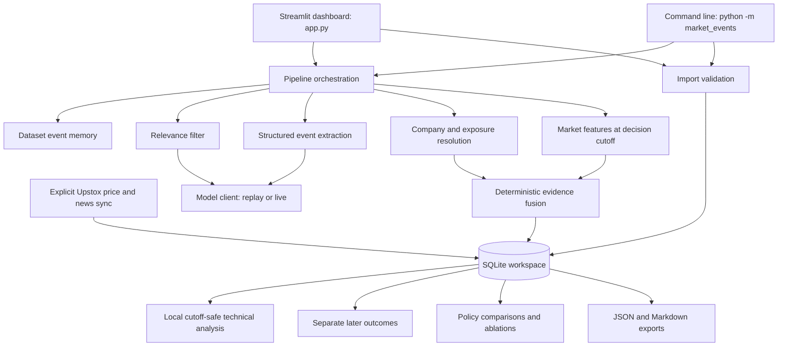
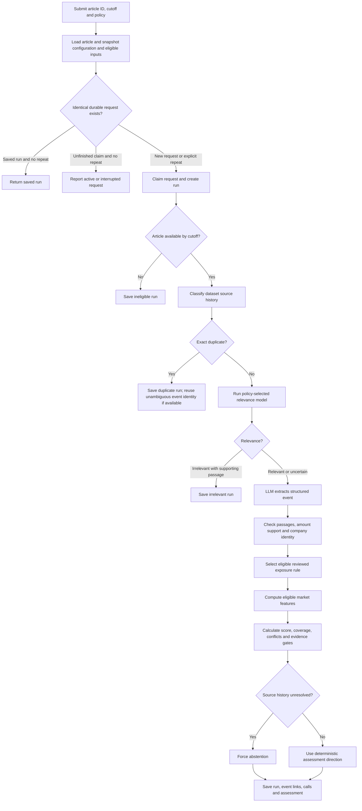
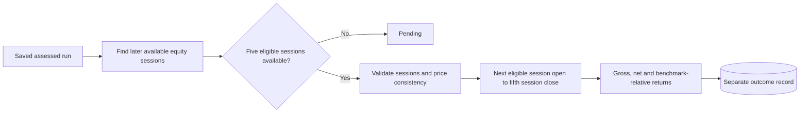

# Market Events Prototype: Full Workflow and Features

Implementation reference: 24 October 2026. Application version: `0.1.0`.

This guide describes the implemented local event pipeline, technical indicators and explicit live-data integration. The final offline suite passed 270 tests; actual account connectivity remains unverified. Proposed extensions are identified separately at the end. Bundled articles, prices, exposure assumptions and recorded responses are synthetic; real inputs use a separate live namespace. See [live setup](docs/LIVE_SETUP.md) for configuration and verification boundaries.

## 1. Purpose and scope

Market Events is a local financial-event research workbench. It turns a dated article and imported market observations into a structured event, a deterministic evidence assessment and an inspectable research record. Independent technical analysis computes indicators from price history without requiring an article or model. Later market outcomes are evaluated separately.

The project combines three kinds of work:

| Component | Responsibility |
| --- | --- |
| Small language model (SLM) | Filter article relevance and provide structured routing hints |
| Large language model (LLM) | Extract the event, company, amounts and supporting source passages; optionally reproduce a saved explanation |
| Deterministic Python modules | Check source support, resolve companies, select historically eligible evidence, calculate features, combine evidence and measure later outcomes |

The implemented agents are specialised functions called by a fixed pipeline. They do not independently plan tasks, browse websites, execute tools or train models. No separate vision model is required by the implementation.

The three event families supported by numerical assessment are:

- `earnings`
- `order_announcement`
- `commodity_supply_disruption`

The extraction schema also accepts `other` and `uncertain`; those families do not qualify for a directional assessment.

## 2. Architecture and code map



| File or directory | Role |
| --- | --- |
| [app.py](app.py) | Workspace controls, forms, tables, saved evidence and downloads |
| [src/market_events/pipeline.py](src/market_events/pipeline.py) | Main analysis workflow, demo, outcome workflow and optional explanation workflow |
| [src/market_events/schemas.py](src/market_events/schemas.py) | Typed records and validation contracts |
| [src/market_events/ingestion.py](src/market_events/ingestion.py) | Article JSONL and market CSV parsing |
| [src/market_events/storage.py](src/market_events/storage.py) | SQLite migrations, immutable records, request claims and persistence |
| [src/market_events/event_memory.py](src/market_events/event_memory.py) | Dataset-relative duplicate, update and new-source classification |
| [src/market_events/agents/](src/market_events/agents/) | Filtering, extraction and constrained explanation functions |
| [src/market_events/model_client.py](src/market_events/model_client.py) | Provider requests, recorded replay, budgets, retries and call traces |
| [src/market_events/config.py](src/market_events/config.py) | Settings, environment overrides and non-secret snapshots |
| [src/market_events/exposure.py](src/market_events/exposure.py) | Canonical company matching and dated exposure-rule selection |
| [src/market_events/market_features.py](src/market_events/market_features.py) | Returns, benchmark alignment, volume context and staleness |
| [src/market_events/technicals.py](src/market_events/technicals.py) | RSI, moving averages, MACD, Bollinger Bands, ATR and ADX |
| [src/market_events/live_data.py](src/market_events/live_data.py) | Offline universe metadata and explicit read-only price/news requests |
| [src/market_events/fusion.py](src/market_events/fusion.py) | Evidence components, coverage, conflicts and abstention |
| [src/market_events/outcomes.py](src/market_events/outcomes.py) | Hypothetical next-open to fifth-session-close outcomes |
| [src/market_events/experiments.py](src/market_events/experiments.py) | Saved-run resource summaries, cohorts and commodity ablation |
| [src/market_events/exporting.py](src/market_events/exporting.py) | Case payloads, bundle JSON, usage JSON and Markdown case reports |
| [src/market_events/__main__.py](src/market_events/__main__.py) | CLI commands |
| [configs/](configs/) and [prompts/](prompts/) | Company universe, exposure/fusion settings and versioned prompt text |

The UI contains presentation and interaction logic. Market calculations belong to the domain modules and are reused by the CLI.

## 3. Complete user workflow

1. Start Streamlit and choose a project root, database path, demo/live data universe and model execution mode.
2. Select **Open workspace** to initialise/read a local SQLite workspace, or **Load synthetic demo (replay)** to import fixtures and run the demonstration.
3. Import article JSONL and market CSV, supply local paths, manually enter an article, or explicitly refresh live price history and optional company news in the connection view.
4. Review accepted records, rejected rows and imported market coverage.
5. For independent technical analysis, select a company and offset-aware cutoff and explicitly submit local computation. For event research, select an article, an offset-aware cutoff and an execution policy.
6. Submit **Analyse and save run**. Select **Explicit repeat experiment** only when a new linked experiment is wanted.
7. In **Saved runs**, inspect source text, event memory, extraction support, exposure assumptions, referenced observations, score, conflicts and model traces.
8. Optionally request the constrained model explanation as a separate action.
9. In **Comparisons**, explicitly evaluate later outcomes, review policy summaries and compare equity-only with commodity-inclusive assessments.
10. Export an individual case, comparison report or CLI research bundle.

Opening the initial page does not create a database or load demo data. After a workspace is open, ordinary UI reruns can read storage, but changing filters or controls does not itself start model inference. The UI demo button always runs replay, regardless of the mode selected for subsequent analyses. Demo loading also evaluates its later synthetic outcomes.

## 4. End-to-end analysis pipeline



Model, validation and budget failures can terminate intermediate stages. They are recorded with their reached-stage context when handled inside the claimed analysis workflow. Invalid inputs encountered before a run is claimed, such as an unknown article or a naive cutoff, raise an error without creating an analysis run.

### 4.1 Load inputs and freeze the analysis context

The pipeline loads the article and converts the cutoff to UTC. It snapshots:

- Runtime settings, excluding API keys.
- The company, exposure and fusion configurations.
- Prompt text and prompt SHA256 hashes.
- Application version.
- A hash of all eligible imported market observations.
- A hash of all eligible imported articles.

An article is eligible only when both `published_at` and `first_seen_at` are at or before the cutoff. A market observation must satisfy both `timestamp <= cutoff` and `available_at <= cutoff`.

This preserves the distinction between the time an event or session occurred and the time its information became available. The hashes cover the eligible imported collections, rather than only the article's eventual selected instruments.

### 4.2 Durable request reuse and explicit repeats

The request key hashes the selected article record, cutoff, execution policy and configuration/input snapshot.

- An identical request with an existing saved run returns that run without new inference. This can include an existing saved failure.
- An existing claim without a saved run is reported as active or interrupted; it is not silently taken over.
- An explicit repeat uses a new request key suffix and run ID. If an earlier identical request exists, its run ID becomes the repeat's `parent_run_id`.
- Changing the article, policy, cutoff, eligible input collections or configuration can create a different request key.

The database claim is committed before model calls. No database transaction remains open throughout inference.

### 4.3 Classify dataset event memory

| Memory status | Meaning | Pipeline behaviour |
| --- | --- | --- |
| `new` | No eligible exact copy or explicit predecessor in the imported history | Continue |
| `duplicate` | Earlier eligible article has the same whitespace-normalised text hash | Stop before filtering/extraction and save the relationship |
| `update` | An eligible explicit predecessor exists and the text changed | Continue; retain event lineage |
| `unresolved` | History is missing, cyclic, inconsistent, or changed at the same source without an explicit predecessor | Continue collecting evidence, then withhold the directional assessment |

Duplicate detection takes precedence over update detection. Only cutoff-eligible history participates. Duplicate articles can link to an existing event when the saved identity and version are unambiguous. Updates trace explicit eligible ancestry to derive a shared event identity.

Memory is exact and conservative: there is no embedding search, semantic deduplication or global news-novelty service.

### 4.4 Filter relevance

The filter returns `relevant`, `irrelevant` or `uncertain`, plus event hints, candidate entities, source passages and a reason.

The application checks that every supplied passage is nonblank and occurs exactly in the article. Unsupported passages cause an `uncertain` decision and clear the unsupported hints. An `irrelevant` response without a supporting passage also becomes `uncertain`.

An accepted irrelevant decision ends the run. Relevant and uncertain articles proceed to LLM extraction.

### 4.5 Extract and validate the event

Extraction returns event type, candidate/canonical company, optional commodity, narrative direction, amounts, source passages and a reason.

The application checks:

- At least one supporting passage exists and all passages occur in the original text.
- Every amount has a source passage containing its value, unit and any stated scale.
- Company identifiers/names/aliases occur with word boundaries in the source.
- The reviewed company universe resolves to one unambiguous company.
- A model-supplied company does not contradict the source-based resolution.

The support status becomes `validated`, `unsupported` or `unresolved`. Unsupported/unresolved extractions may continue to an inspectable assessment, but cannot pass the final evidence gates.

`validated` means the implemented structural/source checks passed. It does not establish the truth of the article or a causal economic interpretation. The schema holds one canonical company per extraction; multi-company articles can remain unresolved.

### 4.6 Resolve commodity exposure

Exposure rules contain a company, commodity, relationship, source, direction (`-1` or `+1`), effective time, known time, version and rule ID.

Selection requires matching company/commodity IDs and both `effective_at <= cutoff` and `known_at <= cutoff`. The latest eligible effective/known vintage is selected. Conflicting latest rules are ambiguous; blank required review metadata makes a rule unusable.

Results are `matched`, `missing`, `ambiguous` or `not_required`. The current crude-oil relationships are explicitly synthetic reviewed assumptions, not measured sensitivities or real-filing-derived exposure estimates.

### 4.7 Select observations and calculate market features

All returns are fractions: `0.01` means 1%. Relative volume is a ratio.

| Feature | Current definition |
| --- | --- |
| Equity return | Latest eligible equity close / previous eligible close - 1 |
| Benchmark return | Benchmark close return over the same two session dates as the equity return |
| Excess return | Equity return - benchmark return |
| Relative volume | Latest equity volume / mean volume of the preceding five observed sessions |
| Commodity return | Latest eligible commodity close / previous eligible close - 1 |

The module also records the supporting observation IDs and lists of missing/stale features.

Additional rules:

- Missing values remain null; they are not replaced with zero or forward-filled.
- At least two observations are needed for a return and six for relative volume.
- Conflicting sessions make the affected series unavailable.
- Return pairs require consistent currency, unit and contract identity.
- Multiple commodity contracts make that commodity series unavailable; there is no contract roll or continuous-futures construction.
- When both equity and commodity return pairs exist, their session dates must align.
- A return is stale when its latest supporting timestamp is more than four calendar days before the cutoff. Stale values remain inspectable but cannot satisfy the evidence gates.

### 4.8 Fuse evidence and decide whether to abstain

Before fusion, a resolved company's eligible equity history also produces a `TechnicalSnapshot`, saved separately on `AnalysisRun.technicals`. Its RSI14, SMA20/50, EMA20, MACD12/26/9, Bollinger20 bands, ATR14 and ADX14 use pure local calculations. Missing warm-ups, stale values and supporting observation IDs remain explicit. Technical context does not change the frozen event-score arithmetic below. An unresolved company keeps its inspectable abstention and has no technical snapshot.

The current baseline is defined in [configs/fusion_rules.json](configs/fusion_rules.json).

```text
clip(x) = max(-1, min(1, x))

equity_component    = clip(excess_return / 0.02)
commodity_component = clip(commodity_return * exposure_direction / 0.03)

score = sum(weight * available_component) / sum(available_component_weights)
coverage = sum(available_component_weights) / sum(expected_component_weights)
```

| Event family / variant | Expected component weights | Mandatory baseline evidence |
| --- | --- | --- |
| Earnings | Equity: 1.0 | Valid excess return |
| Order announcement | Equity: 1.0 | Valid excess return |
| Commodity supply disruption | Equity: 0.6; commodity: 0.4 | Valid excess return, valid commodity return and eligible reviewed exposure |
| Equity-only ablation | Equity: 1.0 | Valid excess return; commodity/exposure requirements removed |

Configured additional required features are also checked. The numerical decision thresholds are:

- Score `>= +0.15`: `positive`.
- Score `<= -0.15`: `negative`.
- Score between those values: `neutral`.
- Minimum coverage: `0.6`.

Missing/stale mandatory evidence, insufficient coverage, unsupported extraction, unsupported event family, unresolved/inconsistent company or unresolved source history causes `abstain`. A partial numerical score can remain visible while direction is withheld. Coverage is component-weight coverage, not a probability or a measure of all data quality checks.

Opposite signs for equity and exposure-adjusted commodity components create a conflict. A conflict can coexist with an internal positive or negative direction; the user-facing label is then `mixed_evidence`.

| Assessment state | Display label |
| --- | --- |
| Abstained | `insufficient_evidence` |
| Neutral or conflicting components | `mixed_evidence` |
| Positive without component conflict | `positive_evidence` |
| Negative without component conflict | `negative_evidence` |

Narrative direction, extracted earnings/order amounts and relative volume do not enter the current numerical score. The score summarises configured market evidence; it is not a trained forecast or a probability of profit.

### 4.9 Persist the research record

After a claimed analysis finishes, the workflow saves its run, reached-stage outputs, model calls, timing and assessment where present. Event/source links, the run, calls and assessment are written transactionally.

The run retains its policy, mode, cutoff, configuration, input hashes, event memory, extraction, exposure, features, assessment, errors and any parent link. Supporting observations can be resolved through their saved IDs without replacing them with newer rows.

## 5. Model execution policies and modes

### 5.1 Policy routing

| Policy | Filter role | Extraction role | Delegated context |
| --- | --- | --- | --- |
| `llm_only` | LLM | LLM | None |
| `slm_filter` | SLM | LLM | None |
| `slm_delegate` | SLM | LLM | Validated filter output supplied as hints |

The extraction receives the full source text in every policy. Delegation adds hints rather than replacing the article with a shorter passage. Lower token usage or latency must therefore be measured; it does not follow automatically from the policy name. SLM and LLM roles are configurable and are not forced to use different model identities.

### 5.2 Replay and live

| Mode | Behaviour | Boundary |
| --- | --- | --- |
| `replay` | Reads recorded responses from the fixture JSON | Requires a recorded article/task and matching fixture content hash/source version; calls no provider |
| `live` | Sends requests to a configured Ollama or OpenAI-compatible endpoint | Performs actual inference on imported evidence; collects no news or market prices |

Live failures never silently switch to replay. An arbitrary uploaded article has no replay response unless a matching fixture was deliberately recorded.

### 5.3 Provider settings, budgets and traces

Configure providers with `SLM_PROVIDER`, `SLM_BASE_URL`, `SLM_MODEL`, `SLM_API_KEY`, and the corresponding `LLM_*` variables. `MARKET_EVENTS_MODE` and `MARKET_EVENTS_DATABASE` control the default mode and database. Local `.env` and optional `configs/settings.json` are read by the settings loader; existing environment values take precedence.

`MARKET_EVENTS_UNIVERSE` selects `demo` or `live`. The live-data settings use a separate excluded `SecretStr` credential, preferring `UPSTOX_ANALYTICS_TOKEN` and accepting `UPSTOX_ACCESS_TOKEN` as an alias. Restart Streamlit after editing `.env`: already loaded process values deliberately retain precedence. Offline readiness means configuration presence/coverage, not a verified provider connection.

| Setting | `Settings` code default | Value in `configs/settings.example.json` |
| --- | --- | --- |
| Maximum attempted requests per run | 4 | 4 |
| Conservative token admission budget | 24,000 | 12,000 |
| Request timeout, seconds | 120 | 60 |
| Maximum output tokens per model request | 1,200 | Inherits code default |

The example JSON is not automatically active: it must be deliberately used as `configs/settings.json`. Inspect the saved runtime snapshot for the settings actually used.

The admission bound uses request byte length plus output-token allowance. It is a conservative local bound, not a provider-token measurement. Each attempt reserves budget. Retryable network/timeout errors and HTTP `408`, `429`, `500`, `502`, `503`, `504` permit one retry, subject to the run budgets.

Each attempted call records task, provider, model identity, requested model where applicable, prompt hash, request hash, usage when reported, latency, retry index, mode, status and error. A different provider-returned model identity produces a compatibility warning. Unknown token usage remains null. API keys are excluded from saved settings.

## 6. Optional explanation workflow

The saved deterministic assessment already includes an explanation. **Request optional explanation** makes a separate model request using the current runtime model settings.

The current explanation prompt requires the response text to exactly equal the saved deterministic explanation and its citations to exactly equal the saved source passages. The application rejects changes. This is an intentionally strict preservation check, rather than free-form reasoning or an article chat feature.

The request creates an immutable child run with its own ID, parent link, mode, timing and calls. On success, the child retains the explanation text and source passages. On failure, the failure trace is saved and the UI keeps showing the original deterministic explanation. The original analysis is unchanged. Explanation usage is reported separately from policy-analysis usage.

## 7. Separate later-outcome pipeline



Outcome evaluation is explicit in the dashboard/CLI; demo loading also invokes it. The workflow considers analysis runs with `completed` or `abstained` status, but abstained assessments produce invalid outcomes rather than hypothetical entries.

1. Require an assessed, resolved company whose direction is not `abstain`.
2. Reject a run flagged with corporate actions in its saved snapshot because adjustment support is unavailable.
3. Find later observed equity sessions whose assumed session open is strictly after the decision cutoff.
4. Require five finished sessions with available bars as of evaluation time.
5. Reject conflicting sessions or inconsistent price units.
6. Use the first eligible session's open as entry and the fifth session's close as exit.
7. Match benchmark entry/exit on the exact corresponding dates where available.

Entry time assumes 09:15 in `Asia/Kolkata`, converted to UTC. The horizon counts five observed sessions including entry. There is no exchange-calendar completeness verification: missing sessions cannot be inferred from the supplied bars.

```text
gross_return     = exit_close / entry_open - 1
net_return       = gross_return - round_trip_cost_bps / 10000
benchmark_return = benchmark_exit_close / benchmark_entry_open - 1
excess_return    = gross_return - benchmark_return
```

The default total round-trip cost is 10 basis points. Missing benchmark evidence leaves benchmark/excess returns unavailable without turning the completed equity outcome into zero. Outcome labels follow net-return sign.

| Outcome status | Meaning |
| --- | --- |
| `pending` | Five required finished/available observed sessions are not yet present |
| `completed` | The defined equity horizon can be measured; benchmark may still be unavailable |
| `invalid` | The run or supplied observations fail eligibility/consistency requirements |

Outcomes are hypothetical long observations regardless of the evidence direction. Negative assessments are not converted to short positions. Outcomes may be recomputed separately; they do not modify the saved assessment. The application does not automatically detect all corporate actions from OHLC data.

## 8. Dashboard feature inventory

| Area | Implemented features |
| --- | --- |
| Workspace | Select project root and SQLite path; explicitly open workspace; explicitly load replay demo; choose replay/live; show article/run counts |
| Import | Upload JSONL/CSV or enter a local path; upload takes precedence; validate rows; report rejected rows; manual article entry with version/predecessor |
| Imported watchlist | Select configured companies; show observation count, coverage start, latest session, availability, close, volume, currency and unit |
| Research inbox | Show article/source times and latest saved company, event type, status and memory; filter by company, type and status |
| Analysis form | Select article, offset-aware cutoff and one of three policies; preview source; request explicit repeat; save result/error |
| Source & event | Original text, source identifier, content hash, version, publication/first-seen times, memory, filter decision, extraction and exact passages |
| Fusion evidence | Evidence label, signed score, coverage, deterministic explanation, conflicts, abstention reasons, feature values, exposure rule and exact referenced bars |
| Model trace | Saved calls, request key, parent link, stage durations and configuration snapshot |
| Later outcome | Separate outcome record or an explicit not-evaluated message |
| Optional explanation | Explicit request, saved child trace, retained result on success and deterministic fallback display on failure |
| Comparisons | Evaluate outcomes; policy summary table and call-count chart; common-input cohorts; commodity ablation; explanation usage; run manifest; outcome table |
| Technical analysis | Explicit local cutoff-based calculation; indicator values, required bar counts, missing/stale status, interpretations and supporting history |
| Connection readiness | Read-only credential-presence and imported-coverage checks; no automatic network calls |
| Live data refresh | Explicit Upstox GET requests, current-master instrument discovery, selected equities plus benchmark, bounded news pages and per-stage report errors |
| Synced-news batch | Separate explicit model action using returned live article IDs and cutoff; ten-article default limit, saved results and visible skipped/failure states |
| Downloads | Individual case JSON and comparison JSON |
| Presentation | Dark Streamlit theme, visible labels, status text, keyboard focus styling and IST display of relevant source/cutoff times |

The watchlist shows the latest imported data, including data imported for later outcome evaluation. It is not a live quote table and is not filtered to the selected decision cutoff. Unanalysed inbox articles remain explicitly unresolved/unextracted; filtering the inbox does not infer their entities.

## 9. Research comparison features

### Policy summaries

Analysis runs are grouped by policy and replay/live mode. The report includes run count, attempted/failed calls, token totals when complete, mean run latency, assessed-run count and abstentions. If usage is missing for any relevant call, aggregate token totals remain null. Zero calls is also unavailable measured usage, not a claim of measured zero consumption.

Explanation child runs have a separate summary. Repeated experiments contribute repeatedly to descriptive totals.

### Common-input cohorts

Cohorts group runs by article, cutoff and mode. They expose represented policies, run IDs, statuses, configuration variation and whether all three policies are present. Fingerprints compare saved snapshots while ignoring local root/database paths.

Presence of all three policies includes failed runs and does not establish a valid controlled experiment. Review model identities, source versions, snapshots, statuses and repeats before drawing conclusions.

### Commodity ablation

The application recomputes equity-only and commodity-inclusive fusion using the same saved extraction, exposure and features. It uses saved rules and records whether a caller-supplied fallback was needed. Missing inputs or unresolved history produce unavailable results.

Ablation does not call a model or change original runs/outcomes. Earnings and order cases can agree across variants because their baseline already uses only equity evidence.

### Development scripts

- [scripts/benchmark_models.py](scripts/benchmark_models.py): actual configured inference on synthetic fixtures; measures filter forwarding/protocol behaviour and source-grounded extraction.
- [scripts/run_policy_comparison.py](scripts/run_policy_comparison.py): explicit live-model development comparison over selected synthetic cases; saves research exports and attempts an optional explanation.

Existing documentation reports a small synthetic local-model pilot. It is development evidence, not a held-out real-market benchmark. Replay timing, fewer calls or successful extraction alone does not demonstrate latency savings, predictive accuracy or profitability.

## 10. Data contracts and validation

### Article JSONL

Each physical line contains one JSON object. Required fields are `article_id`, `source_url`, `text`, `published_at` and `first_seen_at`. Optional fields include `source_version` (default `"1"`), `predecessor_id` and a matching `content_hash`.

```json
{"article_id":"example-001","source_url":"https://example.invalid/announcement/1","text":"EXPLICITLY SYNTHETIC EXAMPLE. Asian Paints reports earnings growth of 12 percent.","published_at":"2026-01-12T13:30:00+05:30","first_seen_at":"2026-01-12T13:35:00+05:30","source_version":"1"}
```

Checks include timezone offsets, nonblank text, first-seen not preceding publication, correct supplied content hash, unique article IDs/source versions within an import, duplicate JSON fields and unknown fields. Content hashing normalises whitespace; it does not perform semantic rewriting.

### Market CSV

```csv
instrument_id,market_family,timestamp,available_at,open,high,low,close,volume,currency,unit,contract_id
NSE:ASIANPAINT,equity,2026-01-12T15:30:00+05:30,2026-01-12T15:35:00+05:30,100,102,99,101,1000,INR,share,
```

The row above is an illustrative synthetic input, not an actual quote. `market_family` is `equity`, `benchmark` or `commodity`. Commodity rows require an explicit `contract_id`.

Validation requires finite positive OHLC prices, feasible high/low relationships, nonnegative volume, timezone-aware timestamps, availability at/after the observation timestamp, required currency/unit fields, valid headers and unique observation keys. Observation IDs derive from instrument, timestamp and contract.

Import parsers retain valid rows alongside row-level errors. Storage additionally enforces immutable identities and relationships; a conflicting storage batch can fail transactionally. Identical stored records are skipped rather than duplicated. Changed data under an existing immutable observation identity is rejected rather than treated as an implicit revision.

These single-row examples illustrate format only. A usable return requires enough preceding observations and a matching benchmark; an isolated row will not satisfy analysis evidence requirements.

## 11. Storage, audit and exported artifacts

| SQLite table | Stored information |
| --- | --- |
| `articles` | Original text, source identity/version, content hash and source times |
| `market_observations` | Identified market bars and availability |
| `events` | First saved extraction baseline for an event/version |
| `event_sources` | Links between event versions and source articles |
| `analysis_runs` | Complete per-run interpretation and saved execution context |
| `model_calls` | Ordered per-attempt inference/replay traces |
| `assessments` | Deterministic assessments |
| `analysis_requests` | Durable request claims and completion state |
| `outcomes` | Separately recomputable later measurements |

Foreign keys, uniqueness constraints, migrations and database triggers protect the research ledger. Source/event/run/call/assessment records are immutable. Different model interpretations remain in their individual runs rather than overwriting the first event baseline. Request state and outcomes are intentionally mutable workflow records.

| Export | Contents |
| --- | --- |
| UI case JSON | Run, article, separate outcome, referenced observations and missing-reference IDs |
| UI/CLI comparison JSON | Policy summaries, explanation summaries, cohorts, ablations, manifest and outcomes |
| CLI bundle JSON | Selected runs/articles/outcomes, referenced decision observations and missing-reference report |
| CLI companion `.usage.json` | Saved model calls and separate outcomes |
| CLI `<export-stem>-cases/` | Markdown case reports with source passages, assessment, features, referenced observations, calls and any outcome |

Exports read saved decisions without modifying them. Bundle observation arrays resolve decision-feature references; they are not an export of the entire market database or a guarantee that all outcome-supporting bars are packaged.

Technical snapshots are retained in run JSON and Markdown case reports. Exported supporting-observation references include the union of event-feature IDs and technical-history IDs, preserving recursive indicator seeds. Old runs without technical snapshots remain readable.

## 12. Run statuses and failure paths

| Run status | Meaning |
| --- | --- |
| `started` | Run created; normally transient |
| `ineligible` | Article was published or first seen after the decision cutoff |
| `duplicate` | Exact earlier eligible content found; no new model extraction |
| `irrelevant` | Supported filter rejection |
| `completed` | Assessment passed mandatory gates; internal direction can be positive, negative or neutral |
| `abstained` | Assessment exists but mandatory evidence/history gates prevent a directional conclusion |
| `partial` | Per-run request/token admission budget exhausted |
| `failed` | Handled model or validation failure |
| `interrupted` | Keyboard interruption recorded before propagation |
| `explanation_completed` | Separate optional explanation child succeeded |
| `explanation_failed` | Separate optional explanation child failed |

An interrupted process can leave a durable claim without a saved result, especially after a hard termination. The prototype requires an explicit linked repeat rather than automatically recovering that work. Storage failures can also prevent a run from being saved; persistence is not a guarantee against disk/database errors.

## 13. Demonstration universe and walkthrough

The configured five-company demonstration universe contains Asian Paints, Berger Paints and Pidilite Industries under materials, plus IndiGo and SpiceJet under aviation. It uses conceptual sector benchmarks and `MCX:CRUDEOIL` with one synthetic fixed contract. These identifiers are demonstration configuration, not a current listing/investability verification.

The fixture set contains 35 synthetic articles and 128 synthetic market bars. Replay demo selection analyses one eligible example per supported event family at `2026-01-12T17:30:00+05:30` (`2026-01-12T12:00:00Z`).

| Fixture | Demonstrated behaviour |
| --- | --- |
| `syn-001` | Asian Paints earnings; supported equity evidence |
| `syn-002` | Berger Paints crude disruption; conflicting equity/commodity components |
| `syn-003` | Pidilite order announcement |
| `syn-004` | Irrelevant article, available for explicit analysis |
| `syn-005` | Uncertain case, available for explicit analysis |
| `syn-031` | Exact duplicate of `syn-001` |
| `syn-032` | Explicit revised earnings update linked to `syn-001` |

For `syn-001`, rounded fixture values are stock return `+1.0%`, benchmark return `+0.2%` and excess return `+0.8%`. The equity component is `0.008 / 0.02 = 0.40`; with full required coverage it produces positive evidence. The article's reported 12 percent earnings growth is extracted context, not the numerical score input.

For a conflict illustration, suppose the equity component is `+0.40` and an eligible negatively exposed company's commodity component is `-1.00`. Then `0.6 * 0.40 + 0.4 * -1.00 = -0.16`. The internal direction is negative, but the display label is mixed because the components disagree. This arithmetic illustration is not a claim that these exact values occur in `syn-002`.

## 14. Local execution and CLI

The README records testing on Python 3.10.21 on Windows. Reproduce the environment with the checked-in lock:

```powershell
python -m venv .venv
.\.venv\Scripts\python.exe -m pip install -r requirements.lock
.\.venv\Scripts\python.exe -m pip install --no-deps -e .
.\.venv\Scripts\python.exe -m streamlit run app.py --server.address 127.0.0.1 --server.port 8501
```

Open `http://127.0.0.1:8501`. Use Python 3.10.21 for the first command to reproduce the recorded environment.

Example CLI workflow from the project root:

```powershell
# Explicitly load synthetic fixtures and run the replay demo.
.\.venv\Scripts\python.exe -m market_events --database data/demo.sqlite demo

# Inspect saved runs in that same database.
.\.venv\Scripts\python.exe -m market_events --database data/demo.sqlite list-runs

# Analyse a recorded fixture; identical saved requests are reused.
.\.venv\Scripts\python.exe -m market_events --database data/demo.sqlite analyse syn-001 --decision-time "2026-01-12T17:30:00+05:30" --policy slm_delegate --mode replay

# Create a separate linked repeat experiment.
.\.venv\Scripts\python.exe -m market_events --database data/demo.sqlite analyse syn-001 --decision-time "2026-01-12T17:30:00+05:30" --policy slm_delegate --mode replay --repeat

# Separately evaluate outcomes and export research records.
.\.venv\Scripts\python.exe -m market_events --database data/demo.sqlite outcomes
.\.venv\Scripts\python.exe -m market_events --database data/demo.sqlite export --output runs/demo-export.json
.\.venv\Scripts\python.exe -m market_events --database data/demo.sqlite experiments --output runs/demo-experiments.json
```

For your own prepared files:

```powershell
.\.venv\Scripts\python.exe -m market_events import-articles data/articles.jsonl
.\.venv\Scripts\python.exe -m market_events import-market data/market_prices.csv
```

Those paths are examples of files you must supply. Arbitrary imported articles require configured live models for inference. The CLI also exposes `init-db`, outcome/export filtering with `--run-id`, import `--file`, and aliases `import-prices`, `evaluate` and `--as-of`.

Global `--root`, `--database` and `--universe` options precede the subcommand. The demo subcommand additionally accepts its own database option and explicit `--mode live-model`; that opt-in invokes configured models on synthetic inputs. Demo loading always forces the demo universe; the dashboard demo button remains replay-only.

New independent commands are `readiness` (offline configuration/coverage) and `technicals COMPANY_ID [--decision-time ISO]` (pure local calculation). The implemented live adapter adds `sync-live [--companies IDs...] [--lookback-days 550] [--no-news]`, followed by the separate explicit `analyse-news --article-ids IDs... --decision-time ISO [--policy POLICY] [--limit 10]` model action. These paths are verified offline with mocked provider/model transport; use [live setup](docs/LIVE_SETUP.md) to configure and explicitly verify an actual account.

## 15. Verification and current limits

The final combined offline suite on 24 October 2026 completed with **270 passed in 18.53 seconds**. Full Ruff checks passed and all **40 Python files** passed the format check. The earlier original-prototype baseline was 197 tests. The extension includes 32 dedicated indicator tests, 26 adapter tests and nine backend workflow tests, alongside UI/storage/export regression coverage. Test command:

```powershell
.\.venv\Scripts\python.exe -m pytest -q
```

The suite covers ingestion, storage, routing, model clients, pipeline behaviour, event memory, exposure, market features, technical indicators, live adapters, fusion, outcomes, exports, experiments and Streamlit AppTest behaviour. Actual-adapter integration uses real parsing/mapping/storage/pipeline code with HTTP transport mocked: it verifies report article IDs/cutoff, first-fetch availability, no model calls during sync, separate explicit model batches and idempotent refresh/request reuse. The CLI missing-token path returns a structured error without network calls.

Replay demo, outcomes, export, technicals and readiness CLI smoke checks passed. An actual-adapter metadata UI smoke exposed five live equity choices with zero network calls or evidence writes. The local Streamlit service on port 8501 returned healthy status. Actual provider-account access, rendered browser/mobile appearance and screen-reader behaviour remain unverified. Passing software checks does not establish held-out real-data model quality or predictive performance.

| Capability | Current boundary |
| --- | --- |
| Provider price/news sync | Explicit read-only Upstox adapter implemented and verified offline; actual account access unverified; no autonomous collection service |
| Real-data research validation | No held-out real-world benchmark established by the bundled demo |
| Prediction model | No trained forecasting model; fusion uses configured deterministic rules |
| Technical indicators | RSI14, SMA20/50, EMA20, MACD12/26/9, Bollinger20, ATR14 and ADX14 implemented; event-score weights unchanged |
| Event-specific scoring | Commodity disruption adds a commodity path; earnings/orders currently share equity-only scoring |
| Company/commodity relationships | Reviewed configuration; no automatic discovery of all exposed companies |
| Multi-company extraction | One canonical company; ambiguous sources can remain unresolved |
| Semantic event memory | Exact hashes and explicit source lineage only |
| Trading calendar/corporate actions | No complete exchange-calendar or automated adjustment pipeline |
| Commodity history | One contract per eligible series; no contract rolling |
| Optional explanation | Exact saved-text/citation preservation, not free-form narration |
| Operations | Local synchronous workflow; no scheduled autonomous worker or automatic claim recovery |
| Shared product infrastructure | No implemented user-account/permission system or production deployment workflow |
| Trading and derivatives | No brokerage execution, funded portfolio, short strategy or derivatives analytics |

## 16. Extensions needed for a full project

The following are future milestones, not existing prototype features:

1. **Verify actual provider access:** configure an account and token, explicitly exercise the implemented Upstox history/news adapter and inspect real coverage. Offline integration has passed; real account success is not yet established.
2. **Domain completeness:** review instrument identifiers and exposure mappings; handle calendars, corporate actions, revisions, units and explicit futures-contract selection.
3. **Held-out evaluation:** create reviewed labels, separate development/test periods chronologically, compare all policies on matched inputs, and measure extraction/filter quality as well as actual latency and usage.
4. **Stronger event-specific evidence:** define and evaluate how earnings surprises, order size or other justified event features should affect assessment; retain transparent baselines and abstention.
5. **Reliable operation:** add scheduled ingestion, background jobs, crash recovery, monitoring, backups and targeted database queries.
6. **Shared deployment:** add user permissions and deployment/recovery procedures; evolve the UI/API/storage only as usage requires.

A practical first extension is one reproducible real-data path from a permitted announcement through source-grounded extraction and cutoff-eligible evidence to a saved assessment and separate later outcome.

## 17. Related project documentation

- [README and startup instructions](README.md)
- [Real-data configuration and indicator setup](docs/LIVE_SETUP.md)
- [Codebase guide](docs/CODEBASE_GUIDE.md)
- [Data dictionary](docs/DATA_DICTIONARY.md)
- [Build contract](docs/BUILD_CONTRACT.md)
- [Model and prompt notes](docs/MODEL_AND_PROMPT_NOTES.md)
- [Experiments and interpretation](docs/EXPERIMENTS.md)
- [Demo and viva walkthrough](docs/DEMO_AND_VIVA.md)
- [MVP implementation guide](MVP_IMPLEMENTATION_GUIDE.md)
- [Project comparison and differentiation](PROJECT_COMPARISON_AND_DIFFERENTIATION.md)

This guide follows the current implementation where older guide examples differ. Saved runtime snapshots remain the reference for any individual analysis.
