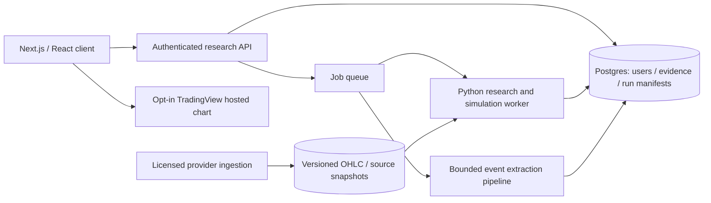

# From research MVP to a complete product

## Can this be a normal Next.js/React website?

Yes. Charts, indicator selection, strategy forms, backtest reports and animated Monte Carlo paths all fit a normal React application. Next.js can supply routing, server-rendered pages, authenticated server endpoints and client components for charts. Browser canvas libraries run in client components. Framework choice does not create trustworthy financial data or valid experiments; those are separate engineering problems.

The Next.js conversion reuses the Python domain modules through a local FastAPI service; the original Streamlit interface is retained. This avoids creating a second quant implementation to reconcile. A small single-user version could run everything in TypeScript, with workers for expensive simulations, but the existing tested Python engine is already an asset.

The diagram below is the **future production target**. Authentication, Postgres and background queues are not added by the local website conversion.

Suggested boundaries: read-only instrument/history endpoints, explicit ingestion jobs, backtest jobs, simulation jobs, immutable result downloads and a separate event-analysis endpoint. Return a job ID for expensive work, expose progress/cancellation and render results only after the job completes. Keep broker/model credentials on the server. Use the same result schemas for Streamlit and React during migration.

## Priorities and acceptance criteria

| Priority | Deliverable | Completion evidence |
| --- | --- | --- |
| 1: trustworthy datasets | Licensed daily history through 2020, corporate-action adjustment metadata, exchange calendar, delisted instruments and dated universe membership | Coverage and missing-session reports; input dataset hashes; reproducible split/dividend treatment; no synthetic/live mixing |
| 2: credible strategy research | Persist strategy configuration, code version, input IDs/hash, fill convention, fees/slippage, train/test dates and outputs | Re-running a manifest reproduces results; future-data perturbation leaves earlier signals/fills unchanged; costs and buy-and-hold are comparable |
| 3: robust validation | Chronological train/validation/test, walk-forward evaluation and parameter sensitivity | Parameters chosen without seeing the final test set; gross/net reports, drawdowns, turnover and exposure; accounting for repeated experiments |
| 4: usable web product | Next.js frontend, stable Python API, saved workspaces, responsive charts and accessible reports | A user can import data, configure a strategy, follow progress, reopen a saved result and download its manifest |
| 5: reliable multi-user service | Authentication, per-user authorization, Postgres migrations, queue, cancellation, quotas, backups and observability | Tenant isolation tests, restart/retry tests, restore drill and visible failed/partial jobs |
| 6: stronger event research | Dated source archive, evaluated entity resolution, reviewed exposure mappings, calibrated abstention and measured model routing | Held-out annotated corpus; extraction precision/recall and grounding checks; measured live latency/token cost; prospective evaluation |
| 7: paper portfolio | Paper orders, ledger, fills, positions, reconciliation and portfolio limits | End-to-end paper simulation with audited cash/positions and explicit failure handling |

These are product-development priorities, not claims that the MVP already provides them. The new strategy lab adds local research functions; it does not provide a production brokerage service, portfolio execution, persistent strategy-job management or a validated predictive model.

## Make the project distinctive

The useful differentiator is the link from **dated article → grounded event → reviewed exposure → numerical evidence → reproducible strategy experiment**. A generic indicator dashboard alone is easy to duplicate. Preserve the existing evidence audit trail, then test whether event features add value against price-only baselines on held-out periods. Show source passages, missing evidence, contradictory signals and operating cost alongside any return chart.

Keep the existing event score separate from new technical strategies until an explicit, versioned event-driven strategy is specified and evaluated. The first strategy lab tests price rules; it does not automatically turn article sentiment into trades.

## Historical research ending in 2020

The user's requested historical boundary is **31 December 2020**. The default study window starts on 1 January 2015 and can be changed to an earlier/later start within that boundary. Provider credentials and permissions still determine whether real history can be downloaded. Importing a validated CSV remains an alternative.

History downloaded today can support retrospective price experiments, but cannot prove that a source, revised price, company list or mapping was available to an investor in 2020. Preserve `available_at` as the real fetch time. A future point-in-time dataset must record historical publication/availability, corrections, corporate actions and universe membership independently.

Monte Carlo resamples historical strategy returns. Its percentile fan and loss frequency describe that simulation under its chosen sample, block length and assumptions. They do not establish calibrated future-market probabilities. Flat or sparse strategy returns can yield uninformative simulations; a convincing animation cannot fix that.

## Chart product boundaries

- TradingView's hosted widget uses TradingView's own data and supported studies. It does not read local SQLite history, enforce our 2020 research boundary, expose its data for our backtests or run arbitrary custom strategies.
- Lightweight Charts renders our imported OHLC and computed indicator series. The application owns data, indicator calculations and backtest logic. Keep TradingView attribution visible and pin the library version.
- If hosted scripts are blocked or offline, show an explicit failure and keep the local result tables/downloads available. The Streamlit extension already bundles pinned Lightweight Charts 5.1.0 locally with its upstream license and notice, removing the chart CDN dependency.

## Primary implementation references

- [Next.js server and client components](https://nextjs.org/docs/app/getting-started/server-and-client-components)
- [Lightweight Charts setup and attribution](https://tradingview.github.io/lightweight-charts/docs)
- [TradingView widget limitations](https://www.tradingview.com/widget-docs/faq/general/)
- [Upstox historical daily availability and request limits](https://upstox.com/developer/api-documentation/v3/get-historical-candle-data/)
