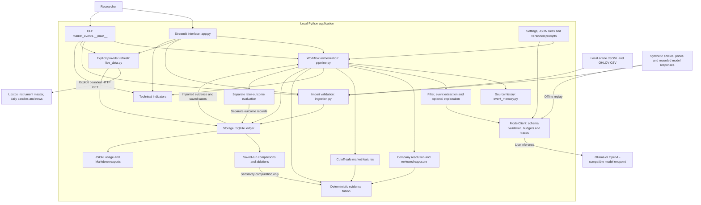
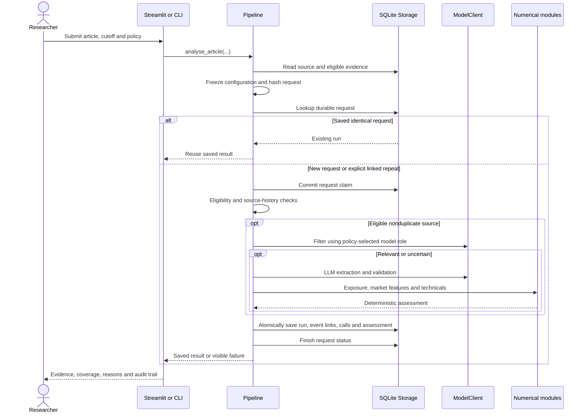
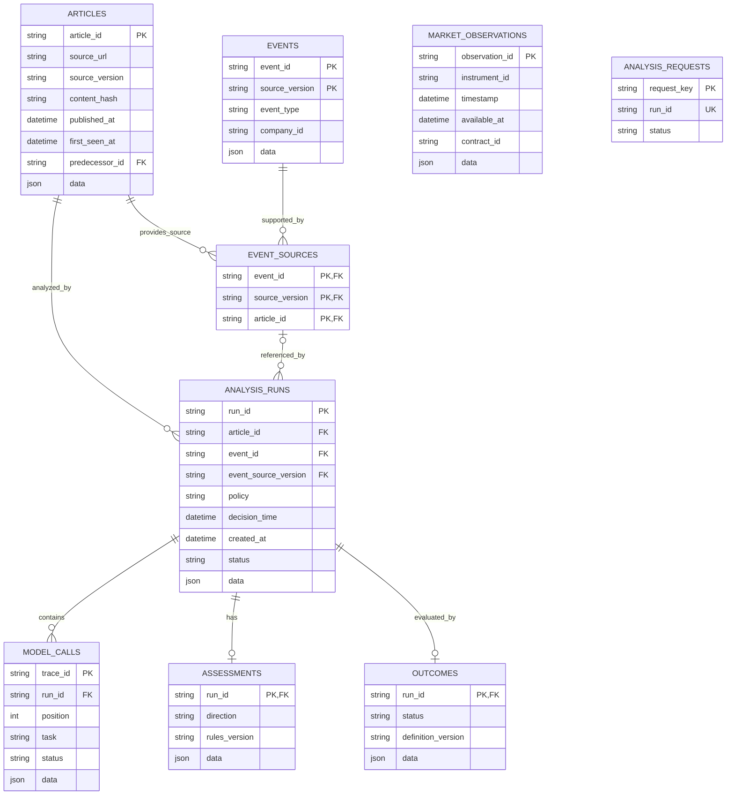
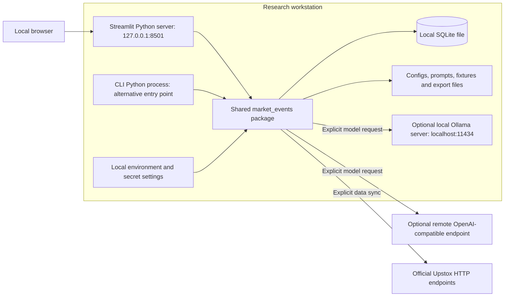

# Market Events — current system architecture

Source inspection date: 26 October 2026. This document describes the implementation inspected in `app.py`, `src/market_events/`, `configs/`, `prompts/`, and `tests/`. Planned functionality is identified separately. Configuration defaults below come from the code, rather than older design examples. No credentials or account data were read to prepare this document.

## 1. System purpose and architectural style

Market Events is a local financial-event research workbench. It converts dated articles and imported market observations into structured, source-grounded events, deterministic evidence assessments, auditable saved cases, and separate later-outcome measurements.

The application is a **modular Python monolith** with two entry points: a Streamlit web interface and an argparse command-line interface. Both call the same domain modules and use a local SQLite database. The `agents/` directory contains bounded model-task functions; it does not implement independently running autonomous services.

The central design boundary separates language interpretation from numerical assessment:

- Models filter articles and extract structured events with supporting source passages.
- Ordinary Python code resolves companies, checks reviewed exposure rules, selects historically available observations, computes market features, and determines the evidence score.
- Technical indicators provide independent price context.
- Later outcomes are computed through a separate explicit workflow and cannot rewrite the original decision.

The score describes available evidence. It is neither a probability nor an order-execution instruction.

## 2. Logical component architecture



Arrows represent dependencies and evidence flow, not separate deployed services. In particular, Streamlit panels can call imports, technical computation, provider refresh, comparisons, and exports directly; `pipeline.py` owns the event-analysis orchestration rather than wrapping every application action.

## 3. Runtime and technology stack

| Concern | Current implementation |
| --- | --- |
| Language | Python 3.10+ declared; README records a tested Windows Python 3.10.21 environment |
| Browser interface | Streamlit 1.x, with local theme configuration and session state |
| CLI | `argparse`, exposed by `python -m market_events` and the `market-events` script |
| Data contracts | Pydantic v2 records, forbidden extra fields, assignment validation on domain records |
| Numerical work | Python numerical/statistical functions; pandas and NumPy are declared dependencies |
| Persistence | Standard-library `sqlite3`; JSON snapshots plus indexed relational columns |
| HTTP | Synchronous `requests` adapters |
| Models | Configurable SLM and LLM roles through Ollama or an OpenAI-compatible endpoint |
| Offline model mode | Exact recorded fixture replay |
| Data provider | Explicit read-only Upstox daily-history and news adapter |
| Configuration | Environment variables, local `.env`, optional `configs/settings.json`, versioned JSON rules |
| Verification tooling | pytest, Streamlit AppTest, Ruff |

The inspected implementation has no separate REST backend, queue worker, scheduler, vector database, user-account service, or broker order-placement path.

## 4. Presentation and workflow entry points

`app.py` exposes seven workbench tasks:

| Task | Responsibility |
| --- | --- |
| Start here | Explicit workspace opening, synthetic demo loading, and workspace overview |
| Import local evidence | Article JSONL, OHLCV CSV, uploads, and manual article entry |
| Analyse an article | Select source, decision cutoff, execution policy, and submit an analysis |
| Review saved results | Display assessment, original source, extracted event, market evidence, traces, and outcomes |
| Explore price indicators | Compute technical context from imported equity bars without articles or models |
| Connect and refresh data | Offline readiness display, explicit provider sync, and separate bounded news analysis |
| Compare research runs | Saved usage summaries, matched-input cohorts, commodity ablations, and explicit outcome evaluation |

The CLI provides corresponding commands including `init-db`, `demo`, `import-articles`, `import-market`, `readiness`, `sync-live`, `technicals`, `analyse-news`, `analyse`, `outcomes`, `list-runs`, `export`, and `experiments`.

Streamlit session state holds navigation, workspace identity, and temporary technical/sync/batch results. SQLite holds durable research records. Changing the project root or database requires explicitly opening the selected workspace. Temporary results are cleared when workspace/universe scope changes. First opening the landing page does not initialize a database, call a model, or fetch provider data.

## 5. Event-analysis execution

The core public operation is:

```python
analyse_article(article_id, decision_time, policy, dependencies, repeat_run=False)
```

`Dependencies` supplies `Storage`, validated `Settings`, and optionally a fresh injected `ModelClient`. Injection supports deterministic tests without real model calls.

Execution proceeds as follows:

1. **Load and validate the request.** Resolve the stored article, require an offset-aware decision time, and select the active demo/local or live namespace.
2. **Freeze configuration and eligible inputs.** Save company/exposure/fusion configuration, prompt text and hashes, application/technical versions, and hashes of eligible market observations and articles.
3. **Apply durable request reuse.** Hash the article, cutoff, policy, and frozen snapshot into a request key. Return the existing saved run for an identical request. A durable claim prevents two callers from independently starting that same request.
4. **Check source eligibility.** Publication and first-seen times must both precede or equal the decision cutoff. The article namespace must match the active universe.
5. **Classify source history.** `event_memory.py` reports `new`, `duplicate`, `update`, or `unresolved`. Exact normalized-content duplicates finish without model calls. An explicit eligible predecessor establishes an update; similarity alone does not merge events.
6. **Filter for relevance.** Select the SLM or LLM role according to policy. Unsupported filter passages become uncertain rather than an unsupported rejection. A grounded irrelevant result terminates the analysis.
7. **Extract a structured event.** The LLM receives the full article, company metadata, and optional verified delegated hints. Validate the response schema, verbatim source spans, amount values/units/scales, and canonical company identity.
8. **Establish event identity.** Explicit update ancestry can share a stable event ID. Every analysis still retains its own extraction, allowing model interpretations to differ without overwriting an earlier record.
9. **Resolve numerical evidence.** Select a reviewed exposure rule, compute equity/benchmark/commodity features, and compute a technical snapshot when a company is resolved.
10. **Fuse evidence deterministically.** Apply frozen weights, scales, thresholds, coverage rules, and mandatory-evidence gates. Unresolved source history forces abstention.
11. **Persist the reached result.** The `finally` block saves the run, model calls, stage timings, and assessment when available, then finishes the durable request state.

Unknown articles and invalid preflight inputs fail before a run is created. Once execution enters the claimed workflow, reached results include `completed`, `abstained`, `duplicate`, `irrelevant`, `ineligible`, `partial`, `failed`, and `interrupted`. Request-table status is a separate, smaller state machine: `started`, `completed`, or `failed`.



An explicit repeat creates a fresh run and request suffix, linked to the existing run when one exists. An unfinished claim is not silently reclaimed. A hard process termination can therefore leave a durable unfinished request requiring an explicit linked repeat.

## 6. Model routing and boundaries

| Policy | Filter role | Extraction role | Delegated hints |
| --- | --- | --- | --- |
| `llm_only` | LLM | LLM | No |
| `slm_filter` | SLM | LLM | No |
| `slm_delegate` | SLM | LLM | Verified filter output |

Even `llm_only` uses a filter stage; it does not bypass filtering. Irrelevant items can stop after filtering under any policy. Relevant and uncertain items proceed to LLM extraction. Delegation retains the full original article, preserving negation, context, and units.

`ModelClient.ask()` loads the appropriate Markdown prompt, appends a JSON schema, builds the request, and validates the returned JSON with Pydantic. The three task types are filter, extraction, and optional explanation.

- Ollama uses `/api/chat`, JSON format, nonstreaming responses, and temperature zero.
- An OpenAI-compatible endpoint uses `/chat/completions` relative to its configured base URL, JSON-object responses, and temperature zero.
- Replay requires a recorded article/task and matching fixture content hash and source version. Unsupported cases fail visibly.
- Live inference never silently switches to replay.

Current code defaults allow four model request attempts per run, a conservative admission budget of 24,000, a 120-second HTTP timeout, and 1,200 maximum output tokens per role. The admission estimate uses serialized request bytes plus the output allowance; it is not a measured provider token count. Each task has at most two attempts, subject to the shared budget. Retries cover selected transient HTTP/network failures and invalid live structured responses.

Every attempted request retains provider/model identity, requested model where relevant, prompt version, request hash, status/error, retry index, latency, and token counts when reported. Missing usage remains unknown.

The optional explanation is unusually strict in this implementation: returned text must equal the saved deterministic explanation and citations must equal the saved extraction spans. It creates a separate child run with its own calls and runtime settings, and cannot modify the parent assessment.

## 7. Numerical evidence and fusion

`market_features.py` computes:

```text
equity_return    = latest_equity_close / previous_equity_close - 1
benchmark_return = aligned_latest_benchmark_close / aligned_previous_benchmark_close - 1
excess_return    = equity_return - benchmark_return
relative_volume = latest_volume / mean(previous_five_session_volumes)
commodity_return = latest_same_contract_close / previous_same_contract_close - 1
```

Benchmark dates must match the equity return interval. Commodity and equity windows must align when both exist. Multiple commodity contracts, conflicting sessions, or inconsistent relevant units can make a feature unavailable. No automatic contract rolling is performed. Values older than four calendar days are marked stale and excluded by fusion.

`exposure.py` resolves one canonical company and selects the latest eligible reviewed exposure vintage. A rule contains company, commodity, relationship, direction `+1` or `-1`, source, version, rule ID, effective time, and known time. Both times must be at or before the cutoff; missing or conflicting mappings remain explicit.

For commodity disruption cases, the current fusion policy is:

```text
E = clip(excess_return / 0.02, -1, 1)
C = clip(commodity_return * reviewed_exposure_direction / 0.03, -1, 1)

coverage = available_component_weight / total_configured_component_weight
score = sum(available_weight * component) / available_component_weight
```

When both components are available, the score is `0.6 * E + 0.4 * C`. Earnings and order announcements use equity evidence alone with weight `1.0`. Relative volume is contextual and does not contribute to the directional score.

With valid mandatory evidence, scores at or above `+0.15` indicate positive evidence; scores at or below `-0.15` indicate negative evidence; intermediate scores are neutral/mixed evidence. Opposing equity and commodity signs retain an explicit conflict, which also affects the displayed evidence label.

Minimum coverage is `0.6`, but coverage alone cannot authorize a result. Commodity disruptions also require commodity return and a valid reviewed exposure. Unsupported event families, unvalidated extraction, unresolved/mismatched company, missing/stale required inputs, and unresolved source history cause abstention even if a partial score exists.

## 8. Independent technical-analysis path

`compute_technicals(observations, decision_time, company_id)` needs imported prices, not an article, provider token, or model. It returns a versioned `TechnicalSnapshot` with values, missing/stale diagnostics, history counts, interpretations, and supporting observation IDs.

| Indicator | Minimum eligible daily bars |
| --- | ---: |
| RSI14 | 15 |
| SMA20, EMA20 | 20 |
| SMA50 | 50 |
| MACD line | 26 |
| MACD signal and histogram | 34 |
| Bollinger20 bands | 20 |
| ATR14 | 15 |
| ADX14 | 28 |

The module documents its SMA seeds, Wilder smoothing, and population-standard-deviation convention. Missing warm-ups produce unavailable values rather than zero. Conflicting session history or currency/unit/contract changes invalidate the eligible series. Technicals are optionally embedded in event runs but never enter the event evidence score.

## 9. Time, ingestion, and provider refresh

The system distinguishes four timestamps:

| Timestamp | Meaning |
| --- | --- |
| Article `published_at` | When the source was published |
| Article `first_seen_at` | When this dataset first had the source |
| Observation `timestamp` | The market session timestamp |
| Observation `available_at` | When the observation became available to this dataset |

All are timezone-aware and normalized to UTC; the UI displays IST. Decision evidence requires both article times, or both observation times, to be at or before the cutoff. Exposure rules similarly separate effective time and known time.

Offline ingestion validates rows independently and returns records, line-level errors, and warnings. Article hashes use whitespace-normalized text. Observation IDs derive from instrument, timestamp, and contract. OHLC relationships, finite prices/volume, timezone requirements, and commodity contract identity are validated before persistence.

`live_data.sync_live()` is a separately submitted read-only refresh:

1. Read local universe metadata and validate requested equities.
2. Download the official NSE instrument master and resolve unique provider instrument keys.
3. Fetch selected equities and their configured benchmark daily candles, defaulting to 550 calendar days of lookback.
4. Label preceding regular NSE session dates at 15:30 IST; conservatively exclude the current local date.
5. Set availability to actual download time. Preserve earliest saved availability for identical observations, and report immutable price revisions as conflicts.
6. Optionally fetch bounded recent provider news, retaining headline and summary without crawling article links.
7. Store content-versioned `LIVE:NEWS:` articles with actual first-seen timestamps and predecessor links for changed source versions.
8. Return counts, errors, warnings, resolved universe metadata, article IDs, request count, and a cutoff after collection finishes.

Default provider limits are 30 requests per sync, 20-second timeout, at least 0.25 seconds between requests, and three news pages per selected equity. Downloads and decoded responses are bounded. Authentication/rate-limit failures stop further provider requests; this adapter performs no automatic retry.

Refreshing data does not invoke models. `analyse_synced_news()` is a separate explicit live-model batch, default limit ten articles, with a bounded range of one to 100 and a visible result for each requested item.

The `demo` and `live` universes are distinct from model mode `replay` and `live`. Local synthetic articles can be evaluated with actual configured models; that remains synthetic evidence. Provider history downloaded today cannot be used as evidence for a decision cutoff before its recorded availability.

The configured demo universe contains Asian Paints, Berger Paints, Pidilite, IndiGo, and SpiceJet, synthetic materials/transport benchmarks, and an explicit crude-oil contract. The configured live universe contains Asian Paints, Berger Paints, Pidilite, InterGlobe Aviation, and Reliance with Nifty 50. These are repository selections, not a verified statement about present market eligibility. Live exposure rules must come from a separate `live_exposure_rules.json`; its absence produces no live mappings. The inspected live provider adapter does not download commodity contracts.

## 10. Persistence and data model

`Storage` manages one SQLite connection per instance, enables foreign keys, and migrates database schema versions through version three. Queries use indexed relational keys while complete Pydantic records are retained as JSON.



`EVENT_SOURCES` and its reference from a run use composite keys. The request-table `run_id` is a logical association, deliberately without a foreign key because its claim must exist before the run is saved. Observation references are lists inside saved feature/technical JSON, rather than foreign-key join rows. Export logic resolves those IDs and reports missing references.

Important persistence properties:

- Article versions, market observations, events, source links, runs, model calls, and assessments are append-only. Database triggers reject updates/deletes and conflicting inserts, including replacement attempts.
- Rewriting the same interpreted record through the Storage API is idempotent; a conflicting record is rejected.
- Event identity is versioned. The first event extraction remains the baseline; each run retains its own full interpretation.
- Saving a run atomically saves event/source links, run data, ordered model calls, and assessment.
- Request claims are committed before inference, so no database transaction remains open during slow model calls.
- Outcomes are deliberately mutable through an upsert, allowing pending measurements to become completed without altering a decision.
- Technical snapshots, parent-run IDs, and configuration snapshots live inside run JSON; they have no separate tables.

## 11. Later outcomes, comparisons, and exports

`outcomes.evaluate_outcome()` measures a hypothetical long holding interval, independently of the evidence score:

- Entry is the first eligible observed session whose 09:15 IST open is after the decision cutoff.
- Exit is the fifth observed session's close, counting entry as session one.
- Bars must be finished and available by evaluation time.
- Gross return is `exit_close / entry_open - 1`.
- Net return subtracts the configured round-trip cost, default ten basis points.
- Benchmark return uses the exact entry/exit session dates; excess return is gross return minus benchmark return.
- Missing horizon data remains `pending`. Abstained or otherwise ineligible decisions produce `invalid` outcomes. Negative evidence does not automatically become a short trade.

Observed sessions do not prove exchange-calendar completeness, and corporate-action adjustment is not automatically inferred.

`experiments.py` reads saved records, separates live and replay usage, separates explanation children from analysis, and identifies common-input cohorts. Commodity ablations call the same deterministic fusion function on frozen saved inputs with commodity evidence included and excluded. Comparisons do not call models or mutate saved decisions.

`exporting.py` creates portable bundles containing original articles, complete runs, saved outcomes, referenced observations, missing-reference diagnostics, a separate usage file, and Markdown cases. Viewing/exporting saved cases does not recompute features using newly imported prices.

## 12. Deployment and operational boundaries



This represents the documented local launch topology. CLI and Streamlit share source modules and can point to the same database file, but are separate processes when launched separately. Ollama is an optional separate server; a configured compatible endpoint may instead be remote.

Settings load `.env` without overriding existing process variables, then read optional JSON settings and apply supported environment overrides. Secret fields use `SecretStr` and are excluded from settings snapshots. Credentials are not entered through the dashboard. Model URLs reject embedded credentials and query strings; the provider adapter uses fixed official download/API hosts.

The current architecture relies on local OS/file access. It does not provide application-level authentication, tenant separation, a remote secret manager, or centralized service observability. Synchronous HTTP and full-list database reads suit a small local research dataset; they limit responsiveness and throughput as datasets and concurrent users grow. Durable request claims prevent duplicate inference but are not a distributed work queue or automatic crash-recovery scheduler.

## 13. Verification evidence and current limits

The test suite covers ingestion, immutable storage and request claims, event history, model routing and validation, exposure selection, market features, fusion, technical indicators, outcomes, provider integration, exports, comparisons, and Streamlit workflows. HTTP mocks support offline provider and model validation.

The README records a previous offline checkpoint of 270 passing tests and passing Ruff checks. That is historical repository evidence; this architecture review did not rerun the suite or make live provider/model requests. The repository documentation also identifies actual provider-account connectivity and rendered browser/mobile/screen-reader behavior as unverified at that checkpoint.

The inspected architecture supports deterministic replay and auditable research. It does not establish predictive accuracy, profitability, calibrated probabilities, complete exchange calendars, or automatic corporate-action adjustment.

## 14. Documented extension versus implemented source

`docs/TRADING_EXTENSION_CONTRACT.md` describes a planned trading-research extension. At this inspection, `strategy_lab.py`, `lab_ui.py`, and `chart_widgets.py` were absent from the source inventory, and `sync_historical()` was absent from `live_data.py`. Therefore the following belong to the documented extension, rather than the implemented architecture described above:

| Planned component | Contract responsibility |
| --- | --- |
| `sync_historical()` | Explicit candles-only historical download, default 2015-01-01 through 2020-12-31, preserving actual fetch availability |
| `strategy_lab.py` | History preparation, causal indicator series, next-open long/cash backtesting, seeded moving-block Monte Carlo |
| `lab_ui.py` | Strategy/date/cost/capital controls, performance results, downloads, and explicit simulation |
| `chart_widgets.py` | Local-data Lightweight Charts and an opt-in independent TradingView widget |
| Possible frontend evolution | Next.js/React is discussed as a future option; the current application remains Streamlit |

These additions can consume the existing observation records and keep numerical computation independent from models. Their existence in a contract does not establish implemented APIs or verified behavior.

## 15. Source map

| Source | Architectural role |
| --- | --- |
| `app.py` | Streamlit task panels, forms, session state, and saved evidence display |
| `src/market_events/__main__.py` | CLI parsing and command dispatch |
| `src/market_events/pipeline.py` | Analysis orchestration, frozen snapshots, request reuse, demo, outcomes, readiness, batch analysis, explanation children |
| `src/market_events/schemas.py` | Validated cross-module data contracts |
| `src/market_events/config.py` | Settings, secret exclusion, universe and rule loading |
| `src/market_events/ingestion.py` | Row-level article/market imports |
| `src/market_events/live_data.py` | Explicit Upstox discovery, history/news sync, parsing, and limits |
| `src/market_events/event_memory.py` | Cutoff-eligible duplicate/update/source-history classification |
| `src/market_events/agents/` | Filter, grounded extraction, and constrained explanation functions |
| `src/market_events/model_client.py` | Replay/live adapters, structured response validation, retry/budget accounting, traces |
| `src/market_events/exposure.py` | Canonical company and reviewed exposure resolution |
| `src/market_events/market_features.py` | Daily numerical event evidence |
| `src/market_events/technicals.py` | Independent, versioned technical context |
| `src/market_events/fusion.py` | Deterministic score, coverage, conflicts, labels, and abstention |
| `src/market_events/storage.py` | SQLite schema, migrations, immutable ledger, request claims, and outcomes |
| `src/market_events/outcomes.py` | Separate later five-session measurements |
| `src/market_events/experiments.py` | Descriptive policy summaries, cohorts, and commodity sensitivity |
| `src/market_events/exporting.py` | Evidence-preserving case and usage exports |
| `configs/` and `prompts/` | Universe metadata, exposure/fusion rules, and model task instructions |
| `tests/` | Offline domain, integration, adapter, and UI workflow verification |
