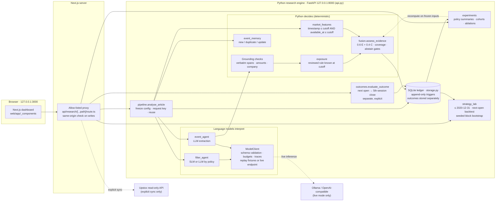

# Architecture diagram (presentation version)

*A Heterogeneous Multi-Agent Framework for Financial Event Detection and Cross-Market Signal Fusion in Indian Financial Markets*: the implementation (Market Events).
The diagram shows the heterogeneous agents (SLM filter agent, LLM event agent, optional explanation agent)
and the deterministic quantitative agents (exposure, market features, fusion), all coordinated by `pipeline.py`.

Verified against source on 2026-11-21: `web/app/api/research/[...path]/route.ts`, `src/market_events/api.py`,
`pipeline.py`, `model_client.py`, `fusion.py`, `market_features.py`, `outcomes.py`, `strategy_lab.py`,
`storage.py`. It extends `docs/SYSTEM_ARCHITECTURE.md` §2, written 26 Oct 2026 before the Next.js
frontend, FastAPI service and strategy lab existed.

## Slide diagram



## Reading the diagram aloud

1. The browser never talks to Python directly. The Next.js route forwards only listed endpoints
   (reads: `health`, `workspace`, `comparisons`, `case/<id>`; writes: `demo`, `import`, `analyse`,
   `technicals`, `history`, `backtest`, `monte-carlo`, `outcomes`, `analyse-news`, `explain/<id>`,
   `sync/live|historical`). It refuses cross-origin writes (`route.ts`; `api.py` `local_boundary`).
2. The left box inside Python is the only place a language model is involved. Everything it returns
   is schema-validated and grounded (`agents/filter_agent.py`, `agents/event_agent.py`).
3. The right box is ordinary deterministic Python. Same inputs give the same score
   (`fusion.py`), and every input is filtered by the decision cutoff (`market_features.py`,
   `pipeline.py` lines 60–79).
4. Outcomes, comparisons and the strategy lab read the ledger. They never rewrite a saved decision.

## Plain-text fallback (if mermaid does not render on the projector)

```text
Browser (Next.js :3000)
  └─ /api/research/* allow-listed proxy (same-origin writes only)
       └─ FastAPI :8000 (api.py)
            ├─ pipeline.analyse_article ── freeze config, hash request, reuse identical runs
            │    ├─ [MODELS INTERPRET]  filter (SLM|LLM) → extraction (LLM) via ModelClient
            │    │                      replay fixtures offline | Ollama/OpenAI-compatible live
            │    └─ [PYTHON DECIDES]    grounding → source memory → exposure rule
            │                           → cutoff-safe features → fusion score / abstain
            ├─ outcomes (separate, explicit)    next open → 5th close, 10 bps round trip
            ├─ experiments (read-only)          policy usage, cohorts, commodity ablation
            ├─ strategy_lab (read-only)         ≤2020-12-31, next-open fills, block bootstrap
            └─ SQLite ledger (append-only runs, calls, assessments; outcomes upserted separately)
```
